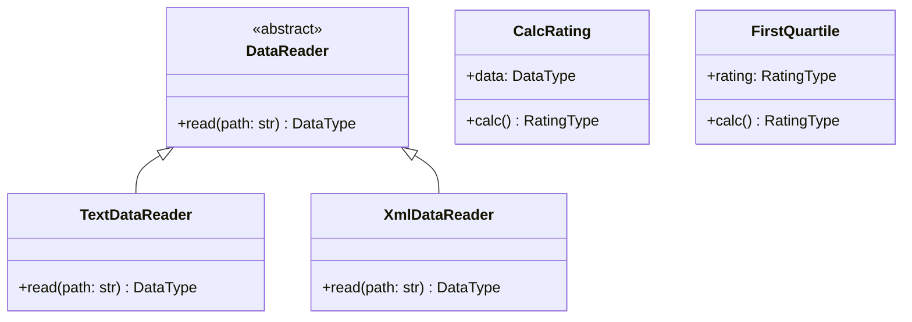

# Лабораторная работа № 1. Git и GitHub Actions

**Вариант 5.** Автор: Andrew.

## Постановка задачи

Взять за основу программу расчёта рейтинга студентов из методички.
Настроить контроль версий и автоматические проверки в GitHub Actions.
По варианту 5 добавить чтение XML и отдельный класс, который определяет
студентов из первой квартили распределения рейтингов. Написать модульные
тесты и составить UML-диаграмму классов.

## Описание проекта

Программа читает ФИО, названия предметов и целочисленные оценки из TXT или XML.
Рейтинг студента равен среднему арифметическому его оценок. В консоль выводятся
рейтинги всех студентов, затем студенты из первой квартили и их рейтинги.
Формат выбирается по расширению файла, регистр расширения не имеет значения.

Структура и названия базовых классов сохранены из методички. Чтение файлов
реализовано через общий абстрактный класс `DataReader`. В отличие от примера,
результат чтения хранится в локальной переменной: повторный вызов не сохраняет
студентов из предыдущего файла. Импорты оформлены через пакет `src`, поэтому
не требуется вручную задавать `PYTHONPATH`.

Используются Python 3.10+, стандартные библиотеки `argparse`, `pathlib`,
`statistics`, `xml.etree.ElementTree`, а также `pytest`, `pycodestyle`, Git
и GitHub Actions. Внешних библиотек для запуска самой программы не требуется.
Лицензия проекта: MIT, текст приведён в [LICENSE](LICENSE).

## Запуск

Команды выполняются из корня проекта. Для Windows PowerShell:

```powershell
python -m venv .venv
.\.venv\Scripts\python.exe -m pip install -r requirements.txt
.\.venv\Scripts\python.exe -m src.main -p data/data.xml
```

Вариант с исходным текстовым форматом:

```powershell
.\.venv\Scripts\python.exe -m src.main -p data/data.txt
```

На Linux и macOS вместо `.\.venv\Scripts\python.exe` используется
`.venv/bin/python`. Запуск через `-m src.main` выполняется из корня проекта.

## Формат данных

TXT соответствует примеру из методички:

```text
Иванов Иван Иванович
    математика:80
    программирование:90
    литература:76
```

XML содержит элементы `student` с атрибутом `name` и вложенные `subject`:

```xml
<?xml version="1.0" encoding="UTF-8"?>
<students>
    <student name="Иванов Иван Иванович">
        <subject name="математика">80</subject>
        <subject name="программирование">90</subject>
        <subject name="литература">76</subject>
    </student>
</students>
```

В XML-примере методички ФИО записаны в названиях тегов с пробелами.
Такой XML некорректен, поэтому имена студентов и предметов перенесены в атрибуты.
В `data/data.txt` и `data/data.xml` находятся одинаковые данные восьми студентов.
Файлы должны быть в UTF-8. У каждого студента должна быть хотя бы одна оценка;
при её отсутствии расчёт сообщает об ошибке. Пустой набор студентов допустим.

## Первая квартиль

Под первой квартилью в задании понимается нижняя четверть распределения:
отбираются все студенты с рейтингом **не выше Q1**. Q1 вычисляется стандартной
функцией `statistics.quantiles` с параметрами `n=4, method="inclusive"`.
Метод учитывает минимум и максимум выборки и использует линейную интерполяцию.

Если отсортированные рейтинги обозначить `x`, индекс границы равен
`i = (n - 1) * 0.25`. Если индекс дробный, граница находится между соседними
значениями. Сравнение проводится до округления; два знака используются только
при выводе. При совпадениях на границе отбираются все такие студенты, поэтому
результат может содержать больше 25% группы.

Для одного студента результат содержит этого студента. Для пустого набора
результат пустой. Если все рейтинги равны, выбираются все студенты.

В примере рейтинги после сортировки:
`55; 65; 70; 75; 82; 83.6667; 90; 95`.
Граница `Q1 = 65 + 0.75 * (70 - 65) = 68.75`.
В конце вывода программы:

```text
Студенты первой квартили:
Сидорова Анна Сергеевна: 65.00
Смирнов Алексей Игоревич: 55.00
```

Порядок вывода соответствует порядку студентов во входном файле.

## Структура

```text
PTLab1/
├── .github/workflows/github-actions-testing.yml
├── data/
│   ├── data.txt
│   └── data.xml
├── src/
│   ├── __init__.py
│   ├── Types.py
│   ├── DataReader.py
│   ├── TextDataReader.py
│   ├── XmlDataReader.py
│   ├── CalcRating.py
│   ├── FirstQuartile.py
│   └── main.py
├── test/
│   ├── test_CalcRating.py
│   ├── test_TextDataReader.py
│   ├── test_XmlDataReader.py
│   ├── test_FirstQuartile.py
│   └── test_main.py
├── .gitignore
├── LICENSE
├── requirements.txt
└── README.md
```

## UML-диаграмма классов



`DataType` — словарь: ФИО → список пар (предмет, оценка).
`RatingType` — словарь: ФИО → средний балл.
Функция `main` выбирает реализацию `DataReader`, передаёт данные в `CalcRating`,
а рассчитанные рейтинги — в `FirstQuartile`. Оба расчётных класса независимы.

## Проверки

```powershell
.\.venv\Scripts\python.exe -m pycodestyle src test
.\.venv\Scripts\python.exe -m pytest test -v
```

Локально на Python 3.13.11 прошли **42 теста**, `pycodestyle` завершился без
замечаний. Проверены оба формата, средний балл, повторное чтение, ошибки XML,
отсутствующие файлы, аргументы командной строки и вывод результата.
Для первой квартили проверены дробные рейтинги, совпадения на границе,
неотсортированные данные, пустой набор и группы из одного, двух, трёх,
четырёх, пяти и восьми студентов. Вывод программы проверен на обоих примерах.

## Git и GitHub Actions

Исходный код размещён в [репозитории PTLab1](https://github.com/Ragendll/PTLab1).
Основная ветка проекта — `main`.
Дополнения разрабатывались последовательно в отдельных ветках:

- `feature/xml-reader` — XML, пример данных и тесты;
- `feature/first-quartile` — расчёт первой квартили и тесты.

Перед объединением каждой ветки выполнены тесты и проверка стиля.
Ветки объединены в `main` с отдельными merge-коммитами (`--no-ff`).
Историю можно посмотреть командой `git log --graph --oneline --all`.

Workflow запускает `pycodestyle` и `pytest` на Ubuntu с Python 3.10 при push,
pull request и ручном запуске. Используются официальные
[actions/checkout](https://github.com/actions/checkout) и
[actions/setup-python](https://github.com/actions/setup-python).

Автоматические проверки успешно выполнены для веток `main`,
`feature/xml-reader` и `feature/first-quartile`. Результаты доступны
во вкладке [Actions](https://github.com/Ragendll/PTLab1/actions).

## Выводы

Базовая программа дополнена чтением XML и выборкой студентов первой квартили.
Общий интерфейс чтения позволил сохранить один расчёт рейтинга для двух форматов.
Для XML достаточно стандартной библиотеки Python. Отдельные тесты проверяют
расчёты и чтение данных, а проверки командной строки — их совместную работу.
Дополнения разработаны в отдельных ветках Git и объединены с основной веткой.
В GitHub Actions настроены автоматический запуск тестов и проверка стиля кода.
Проверки основной ветки и веток с дополнениями завершились успешно.
